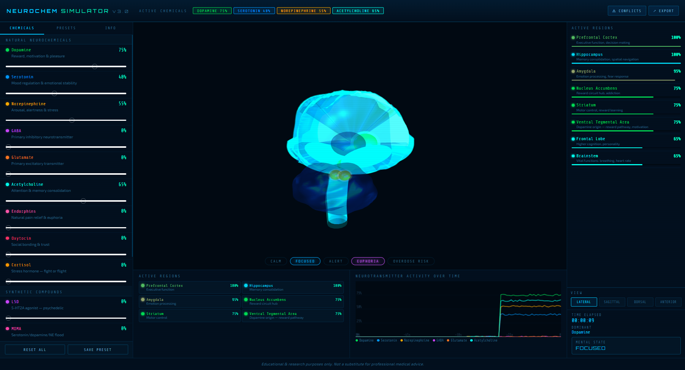

# Neurochem Simulator

Real-time, educational brain simulation. Set the levels of the brain's own neurochemicals
(dopamine, serotonin, GABA, oxytocin…) and of common substances, and watch the regions they act on
light up on an interactive 3D brain, with the resulting mental state and the activity over time.

**Live demo:** https://haralamposmoutidis-source.github.io/brain/

## Features
- **Natural neurochemicals:** dopamine, serotonin, norepinephrine, GABA, glutamate, acetylcholine,
  endorphins, oxytocin, cortisol, each with a dosage slider.
- **Synthetic compounds:** caffeine, alcohol, THC, psilocybin, LSD, MDMA.
- **Scenario presets:** deep sleep, flow state, meditation, anxiety, fight or flight, and more;
  quick states (calm, focused, alert, euphoria, overdose risk) and your own saved presets.
- **3D brain** (lateral, sagittal, dorsal and anterior views) with the active regions and their levels.
- **Mental state and dominant chemical**, activity graph over time, conflict warnings between substances.
- **Export** of the current state as JSON.

## Tech
A single HTML file: HTML, CSS and JavaScript with [three.js](https://threejs.org/) for the 3D view.
Hosted on GitHub Pages.

## Disclaimer
For education and research only. Not a substitute for professional medical advice.

---
© 2026 Haralampos Moutidis. All rights reserved.
